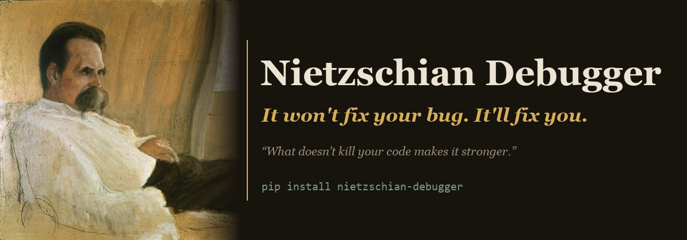

# Nietzschian Debugger



[](https://pypi.org/project/nietzschian-debugger/)
[](https://pypi.org/project/nietzschian-debugger/)
[](LICENSE)

> "What doesn't kill your code makes it stronger."

**It won't fix your bug. It'll fix you.** Every other tool hands you the answer; Nietzschian Debugger hands the question back.

You paste your bug. It doesn't fix it. Instead, it:

- Challenges your assumptions about what's happening
- Forces you to confront the evidence you're avoiding
- Attacks the assumption you're proudest of — the one you stopped questioning
- Guides you to the fix yourself — your realization, not the AI's

## Why?

AI is making developers weaker. Copy-paste from ChatGPT, ship, repeat. Nobody understands their own code anymore. **Nietzschian Debugger forges stronger developers** — through struggle, not shortcuts.

This isn't anti-AI — it runs on Claude, on purpose. It's anti-*outsourcing-your-thinking*. Every other tool uses the model to hand you the answer; this one uses it to hand the question back.

> "He who has a why to debug can bear almost any how."

## Installation

```bash
# Python 3.10+
pip install nietzschian-debugger
nietzschian debug "your bug"
```

**No API key yet? See it in action first — no key, no cost:**
```bash
nietzschian demo
```

> **Note:** the current tool is the Python package above. The old `npx nietzschian-debugger` serves a stale pre-rewrite build — it has been deprecated in favour of the pip install.

**Requirements:**
- Python >= 3.10
- An Anthropic API key (BYOK) — *or* bring another model (OpenAI, Gemini, DeepSeek, …), or run a local **Ollama** model, which needs no key. See [Models — set one up, switch any time](#models--set-one-up-switch-any-time).

## Setup

Set your Anthropic API key:

```bash
# Linux / macOS
export ANTHROPIC_API_KEY="sk-ant-..."

# Windows (PowerShell)
$env:ANTHROPIC_API_KEY = "sk-ant-..."

# Windows (CMD)
set ANTHROPIC_API_KEY=sk-ant-...
```

## Quick Start

```bash
# Start a debugging session (adaptive by default — it reads your state and shifts lens)
nietzschian debug "My API returns 500 but only on Tuesdays"

# Force a single lens instead of adapting
nietzschian debug --lens socrates "My login endpoint fails randomly"
nietzschian debug --lens zarathustra "Memory leak in production"

# Point it at specific code
nietzschian debug "Auth fails in ./src/middleware/auth.ts"

# Interrogate your actual uncommitted changes (feeds the git diff as context)
nietzschian debug --diff "tests started failing after my last change"

# Use any model — Claude by default; or OpenAI, Gemini, DeepSeek, local Ollama…
nietzschian debug --model ollama:llama3.1 "my function returns null sometimes"
```

## Models — set one up, switch any time

**Claude is the default and the sharpest experience.** With `ANTHROPIC_API_KEY` set,
every command just works with no flags. But the tool is model-agnostic — it speaks
the OpenAI API, so almost any hosted or local model works too.

### Switching models

The model is chosen *per command* with `--model`. There's no config to edit and no
state to reset — you switch just by changing the flag, or **drop it to return to
Claude**:

```bash
nietzschian debug "my bug"                                # Claude (needs ANTHROPIC_API_KEY)
nietzschian debug "my bug" --model openai:gpt-4o-mini     # a hosted model
nietzschian debug "my bug" --model ollama:llama3.1        # a local model, no key
```

The flag isn't sticky — each run is independent. (There's no mid-session switch yet;
to change model, re-run the command with a different `--model`.)

### Hosted models (bring your own key)

Set the matching key, then select the model:

```bash
export OPENAI_API_KEY=...     # or GEMINI_API_KEY, DEEPSEEK_API_KEY, GROQ_API_KEY, …
nietzschian debug --model openai:gpt-4o-mini "..."
nietzschian debug --model deepseek:deepseek-chat "..."
nietzschian debug --model gemini:gemini-1.5-flash "..."
```

Supported: **openai, gemini, deepseek, groq, mistral, together, openrouter, xai** —
plus `custom:<model>` with `NIETZSCHIAN_BASE_URL` for any other OpenAI-compatible endpoint.

### Local models with Ollama (no key, no cost, offline)

```bash
# 1. Install Ollama (https://ollama.com) and make sure it's running
# 2. Pull a model once:
ollama pull llama3.1
# 3. Add the provider deps once, then point the tool at it:
pip install "nietzschian-debugger[providers]"
nietzschian roast ./messy.py --model ollama:llama3.1
```

(LM Studio works the same way: `--model lmstudio:<model>`.)

### Which local model should I use?

Different jobs reward different kinds of model — and the twist is that the *best*
model for `predict` is the *worst* for `roast`:

| Command | Best local model | Why |
|---|---|---|
| **`roast`**, **`debug`** | a **general chat** model — `llama3.1`, `qwen3` | built for prose and wit |
| **`predict`** | a **coding** model — `qwen2.5-coder` | it wants a precise function call — exactly the dare |

A coding model asked to *roast* reaches for JSON instead of a joke; a chat model asked
to *predict* is vaguer about the exact return value. Match the model to the job.

> Honest caveat: the "never give answers" discipline is sharpest on **Claude**.
> Smaller local models leak and over-ask more — the built-in validator and the
> roast/predict guards catch a lot of it, not all.

## Share a session

Your sessions are made to be shared. Turn the last one into clean markdown:

```bash
nietzschian share            # most recent session, to your terminal
nietzschian share -o run.md  # or save it to a file
```

## Three Lenses — it picks, not you

By default it **adapts**: each turn it reads where you are and shifts between three methods. You don't choose a difficulty — a confused developer can't diagnose their own state, so the tool reads you instead. Nietzsche is home; it shifts only on sustained signals, not twitchily, and the active lens shows in every turn header (`[Turn 3 · socrates]`).

| When you're… | Lens | What it does |
|---|---|---|
| **confused** — you don't know what you mean | `socrates` | Relentless clarification. Defines your vague terms until a testable claim appears. The stingray, not a gentle mentor. |
| **avoiding** — hiding in an assumption | `nietzsche` | The tuning fork. Taps the idol you're proudest of and listens for the hollow ring. |
| **defeated** — ready to quit | `zarathustra` | Affirmation. Reframes the bug as the weight that makes you stronger, and will not let you quit. |

None of them is soft — **adaptivity changes the angle of the blade, never sheathes it.** To pin one lens instead of adapting:

```bash
nietzschian debug --lens socrates "my bug"
nietzschian debug --lens zarathustra "my bug"
```

## How a Session Looks

```
$ nietzschian debug "login endpoint returns 403, but only for users who signed up before last week; new signups work; same code path; Node/Express"

Nietzschian Debugger [Adaptive mode]


[Turn 1 · nietzsche]
You said "same code path" — but the data is screaming that something
changed between last week and today.

What is different about the user record itself between those who signed
up before last week and those who signed up after?

> I assumed the records were identical. Let me actually compare one.

[Turn 2 · nietzsche]
"Assumed." There is the word you built a week of debugging on. Stop
assuming and read two rows side by side.

What field exists on an old account that a new signup was never given?

> ...the old ones carry a legacy role claim the new ones don't, and the
  auth middleware rejects any token without it.

[Turn 3 · nietzsche]
There it is. The bug was never in the code — it was in your certainty
that "same code path" meant "same data." You stopped looking exactly
where the difference lived.

> found it

Session Complete -- 3 questions to root cause (Solved)

Your Debugging Profile:
┣ Assumption-checking    ████████░░  strong
┣ Evidence-gathering     ██████░░░░  moderate
┗ Root cause speed       ████████░░  strong

"Man is something that shall be overcome."
 -- Friedrich Nietzsche
```

**Or when you call a test "flaky":**

```
$ nietzschian debug "integration test passes locally but fails in CI — it's flaky, I just rerun until it's green"

Nietzschian Debugger [Adaptive mode]


[Turn 1 · nietzsche]
"Flaky." The word you reach for when a test has found something true and
you'd rather it hadn't. A test that fails one run in three isn't random —
it's telling you something is ordered that you assumed was not.

What does CI have, or do in a different order, that your machine does not?

> idk, maybe the database isn't ready yet

[Turn 2 · nietzsche]
"Maybe" — you named a suspect and refused to question it in the same
breath. A database that wasn't ready would throw a connection error, not a
wrong answer. Unless your test is reading rows another test wrote.

Do your tests share a database, and are they guaranteed to run in order?

> ...they share one. locally they always run alphabetically

[Turn 3 · nietzsche]
There it is. "Flaky" was the mask on a race you refused to see — two tests
fighting over the same rows, hidden on your machine by an accident of
alphabetical ordering that CI parallelizes away. The test was never flaky.
It was honest, and you were not.

Will you isolate the data, or keep rolling the dice until they fall green?

> oh. found it

Session Complete -- 3 questions to root cause (Solved)

Your Debugging Profile:
┣ Assumption-checking    ███████░░░  strong
┣ Evidence-gathering     █████░░░░░  moderate
┗ Root cause speed       ████████░░  strong

"No victor believes in chance."
 -- Friedrich Nietzsche
```

## Prove You Understand It — `predict`

`debug` interrogates a bug. `predict` interrogates **you**: it dares you to say what
one of your functions returns, then **runs the code** for the truth — never a model
guessing (that can be confidently wrong). At the end it names the *pattern* in your
misses, not a score.

```bash
nietzschian predict ./parsers.py          # 3 dares by default
nietzschian predict ./parsers.py -n 5     # go five rounds
```

```
$ nietzschian predict ./parsers.py

Nietzschian Debugger [predict mode]

3 rounds — type 'quit' (or press Ctrl+C) to stop early.

── Round 1 of 3 ──

You named it truncate, and now you believe it truncates. Sweet certainty. But
look — you gave length a default of zero, and zero is a falsy little god that
answers "if not length". So tell me, prophet:
what does truncate("hello world") return?

your prophecy > "" — it truncates to zero, so nothing

Wrong, and gloriously so. "if not length" caught your zero and handed back the
text untouched, before a single character was cut. You read the name and never
the first line. The guard fired; your logic never ran.

The truth, once run — it returned 'hello world'.

── Round 2 of 3 ──

You wrote dedupe, and I can smell the doubt — most who write it reach for a set
and let the order rot. Did you keep the order, or did you betray it?
what does dedupe([3, 1, 2, 1, 3]) return?

your prophecy > [3, 1, 2]

Right — and not by luck. You kept the first sighting of each and dropped the
echoes. Clean. There was no trap here; some things you simply know.

The truth, once run — it returned [3, 1, 2].

── Round 3 of 3 ──

A tier function, a border drawn at one hundred. Borders are where confidence
goes to die. Stand on the line itself and tell me which side claims you:
what does shipping_tier(100) return?

your prophecy > "freight" — 100 is the heavy tier

Wrong. "weight > 100", and one hundred is not greater than one hundred. You
stood ON the boundary and assumed it pulled you across; it let you fall back to
'parcel'. The strict > you typed yourself is the thing you forgot.

The truth, once run — it returned 'parcel'.

Proof of Understanding

Two of three — and the two you missed were cut from the same cloth. You read
functions by their name and their happy middle, and walk straight past the lines
that quietly decide everything first: the falsy default that returns early, the
strict > that owns its edge. You trust what the code is *for* over what it
*says*. Read the guards before the gift — the boundary is not an afterthought,
it is the whole argument.
```

> It runs your code in a separate process with a timeout — your own functions, called
> the way you'd call them. It only picks functions it can invoke with simple literal
> arguments, and a function that raises is a legitimate answer (predict that too).

## Roast Your Code — `roast`

For when you don't want a question or a fix — you want the truth, fast and funny.
Point it at your worst file; it reads the code's cowardice and laughs. Fixes nothing.

```bash
nietzschian roast ./legacy/utils.py
```

```
$ nietzschian roast ./legacy/utils.py

🔥 Nietzschian Roast

A function named `helper` wrapping a bare `except: pass` — you built a room with
no windows and called it tidy. The bug you're hiding from in there is the only
honest thing you've written all week.
```

> "Not by wrath does one kill, but by laughter." — *Thus Spoke Zarathustra*

## Session Commands

| Command | Effect |
|---------|--------|
| `solved` or `found it` | End session — you found the root cause |
| `I give up` | Get one lifeline question, then exit |
| `exit` or `quit` | Abandon session immediately |
| `Ctrl+C` / `Ctrl+D` | Force quit |

## Features

- **Refuses to Hand You the Fix** — Every response is a question. It's built to withhold the answer, and a model-judge double-checks each reply to catch it when it slips.
- **Proof of Understanding** — `predict` dares you to say what your code returns, then *runs it* for the truth (never a model guessing) and names the pattern in your misses.
- **Nietzschian Roast** — `roast` reads your worst file and burns it down in one or two lines. Fixes nothing. Deeply shareable.
- **Real Code Reading** — Reference a file path and it reads YOUR actual code, not generic examples. `--diff` feeds it your uncommitted changes.
- **Any Model, Even Local** — Claude by default; or OpenAI, Gemini, DeepSeek, Groq, and more — or a local Ollama / LM Studio model with no key and no cost.
- **Try With No Key** — `nietzschian demo` runs a full scripted session so you can see it before committing a key.
- **Shareable Sessions** — `nietzschian share` exports a session as clean markdown you can post.
- **Adaptive Lenses** — it reads your state each turn and shifts between Socrates (when you're confused), Nietzsche (when you're avoiding), and Zarathustra (when you're defeated). You don't pick the difficulty; it reads you.
- **Growth Score** — Track your debugging skills across sessions with visual bar charts.
- **Session History** — All sessions saved locally in `.nietzschian/sessions/` for trend tracking.
- **Sliding Context** — Long sessions don't crash; older turns are transparently summarized.

## Development

### Run this fork locally

Use an editable install in a virtual environment so the command runs this checkout,
not a separately installed PyPI copy:

```bash
cd /Users/bartvanderwal/Code/nietzschian-diagnoser
python3 -m venv .venv
source .venv/bin/activate
python -m pip install -e ".[dev,providers]"

# Verify which source is being imported
python -c "import nietzschian_debugger; print(nietzschian_debugger.__file__)"

# New fork-only mode: questions about a personal situation, not debugging
nietzschian reflect "I keep postponing decisions"
nietzschian reflect "I keep postponing decisions" --model ollama:llama3
```

`reflect` is psychology-informed self-reflection, **not diagnosis, treatment, or
therapy**. It asks one question at a time, with a retry for responses failing the
question/answer heuristics. These checks are not a guarantee of clinical safety.
Urgent safety responses may override question-only behavior. Stop with `quit`,
`exit`, Ctrl+C, or Ctrl+D.

Text goes to the selected model provider. Unlike debugging mode, reflection does
not automatically read file paths, execute code, score you, or save sessions.
Avoid sensitive details with unapproved hosted providers; a local model is also
supported. Long conversations may reach the provider's context limit.

Change the reflection persona in
[`SYSTEM_PROMPT`](nietzschian_debugger/commands/reflect.py); edits take effect on the
next run without reinstalling. Existing `debug`, `roast`, and `predict` commands
remain unchanged on this feature branch.

The psychology feature is fork-only. The independent `security/predict-sandbox`
branch contains the upstream sandbox proposal; it is not part of this feature.

```bash
# Clone and install
git clone https://github.com/DilawarShafiq/nietzschian-debugger.git
cd nietzschian-debugger
pip install -e ".[dev]"

# Run the test suite
pytest

# Run the CLI locally
nietzschian debug "test problem"
```

## Webdemo: Nietzschian AI Clinician (fork only)

The fork includes a React chat interface with Dutch/English UI and **two explicit
system prompts**, combined with Socrates, Nietzsche, Zarathustra, or Karl Popper mode instructions.
This yields **eight assembled prompts**: four thinkers, each in Dutch and English.
The selected instructions are actually sent to the model for each live turn; switching
the thinker affects subsequent turns, not just the avatar. The demo has separate
fixed answers for each thinker. Popper focuses on falsifiability, counterevidence,
testable predictions, and distinguishing lack of refutation from proof.
These are clinical-reflection adaptations, not copies of the Python debugger prompts.
The three original partners have generated portraits; Popper has a symbolic SVG
illustration. You can inspect the active
prompt in the UI. This is an educational reflection demo, not a clinician, medical
device, diagnostic system, or treatment recommender.

### Run locally

```bash
cd web
npm ci
# Optional: create web/.env and set ANTHROPIC_API_KEY and CLAUDE_MODEL.
# A server-side key in the repository's existing .env is also supported locally.
npm run dev
# Open http://127.0.0.1:3080
```

The app starts in **Scripted demo** mode. Suggested topics produce fixed,
philosopher-specific reflection questions in Dutch or English, with follow-up
choices after each answer. The themes include working hypotheses, counterevidence,
interdisciplinary perspectives, uncertainty, longitudinal evaluation, and human
responsibility. They illustrate the research concept, not a validated clinical
protocol or a claim of improved patient outcomes.

Free text receives an explicit notice that no actual LLM integration is running.
Demo conversation text stays in page memory; it is not sent to a backend. Demo
answers have a separate counter: chatrequests, model calls, and actual tokens
remain zero. The token estimate is explicitly hypothetical in demo mode.

Select **Live model** to use the backend locally, or with a configured separate
backend. This option is unavailable on GitHub Pages without a backend URL.
Select **Claude** or **GreenPT** and enter that provider's key in the top connection
panel. Switching provider clears the conversation and key to prevent accidentally
sending them to another service. Keys stay only in page memory
and is sent to the Express backend in the JSON body of `POST /api/chat`. It is not
saved in browser storage or echoed in responses. Use only a backend you trust:
its operator and browser scripts/extensions can access the key. Clearing the field
or refreshing forgets it; that does not erase provider-side records. Never put keys
in `VITE_` variables, source files, GitHub Pages builds, or URLs.

Live mode uses the real Anthropic SDK for Claude and an OpenAI-compatible SDK for
GreenPT, not canned demo responses. The default Claude model is
`claude-haiku-4-5-20251001`; override it with `CLAUDE_MODEL`. Calls may incur
charges. Invalid keys, missing configuration, provider errors, and rate limits are
shown explicitly. A response failing question/advice heuristics is retried once;
this is not a clinical safety guarantee. No conversations are persisted by this app.
Use fictional or de-identified practice cases only, and an approved provider.

Counters show browser chat requests (including failures), model call attempts
reported by the backend, and actual input/output/cache tokens returned by the provider.
Usage is cumulative across providers for this page session. For GreenPT, cached
prompt tokens (when reported) are separated from input to avoid double counting;
cache-write counts are not exposed by this adapter. Missing provider usage fails
explicitly instead of being reported as zero.
Retry usage is included. Failed requests can have unknown usage. The next-input
estimate uses characters divided by four plus message overhead, including the
prompt and full conversation history; it is **not an exact provider tokenizer**.
Output is capped at 512 tokens per provider call. Conversation size is capped
explicitly; it is never silently truncated. Counters reset on page reload, not on
starting a new conversation. Static-asset requests and CORS preflights are excluded.

```bash
npm test
npm run build
npm start
```

Markdown responses render as formatted text, lists, emphasis, code, and tables.
Raw HTML is disabled, unsafe link protocols are filtered, and embedded remote images
are not loaded. The composer uses larger text, a resizable multiline input, and
page reflow rather than a fixed viewport height so browser zoom does not squeeze it.

Tests use an injected fake provider and never spend model credits. The server binds
to `127.0.0.1` by default, limits calls to 20 requests per IP per ten minutes, and
does not log prompts or keys. This demo has **no authentication**: do not expose
a paid server key publicly. CORS is not authentication or an abuse-prevention system.

### GreenPT connection

The [official quickstart](https://docs.greenpt.ai/get-started) documents an
OpenAI-compatible EU base URL, `https://api.greenpt.ai/v1`. The backend calls
`POST /chat/completions` with bearer authentication. Users cannot substitute a
custom provider URL, preventing accidental key transmission to arbitrary endpoints.

Configure a server-side key, or enter a temporary key in the top UI panel:

```text
GREENPT_API_KEY=your-key
GREENPT_MODEL=mistral-small-3.2-24b-instruct-2506
```

The default is listed in the [official model catalogue](https://docs.greenpt.ai/models);
check availability for your account before use and override `GREENPT_MODEL` as needed.
Model selection is server-controlled. Do not assume a regional endpoint alone
establishes clinical/privacy approval: review your organisation's provider agreements.
The integration is tested with fake completions; a live GreenPT account/key is
required to validate an actual completion.

### GitHub Pages: scripted demo without a server

The static demo needs **no API key, Express host, or repository variable**.
In Settings > Pages select **GitHub Actions**. The
`Clinician demo on GitHub Pages (fork only)` workflow tests and builds the frontend
and deploys `web/dist/client` on web/workflow changes pushed to `main` or
`feature/psychology-reflection`, or on manual dispatch.

The workflow is restricted to `bartvanderwal/nietzschian-diagnoser` and uses the
`/nietzschian-diagnoser/` asset base path. It does not publish the research proposal,
server source, environment files, or API keys.

Expected URL: <https://bartvanderwal.github.io/nietzschian-diagnoser/>.

### Optional: GitHub Pages frontend + separate Express backend

GitHub Pages (like GitLab Pages) cannot run Express. The current app deliberately
uses an Express backend for live providers. This is an architecture choice, not a
universal CORS limitation: Claude's official SDK supports opt-in browser access
with `dangerouslyAllowBrowser: true`, with increased exposure of the user's key.
A no-key preflight from the Pages origin was allowed by Claude during testing;
the equivalent GreenPT check returned 403 without CORS permission from the test
environment, so direct-browser GreenPT support has not been verified. This app
does not currently implement direct-browser provider calls.

Deploy the Node backend separately with HTTPS,
install dependencies with `npm ci`, build with `npm run build`, and run `npm start`
from the web directory. Configure:

```text
HOST=0.0.0.0
PORT=3080
FRONTEND_ORIGIN=https://bartvanderwal.github.io
ALLOW_SERVER_KEY=false
CLAUDE_MODEL=claude-haiku-4-5-20251001
```

With `FRONTEND_ORIGIN` configured, visitors must supply their own temporary key
unless `ALLOW_SERVER_KEY=true` is explicitly enabled. Only the configured origin
and same-origin clients receive browser access. Use HTTPS end-to-end. Configure
your hosting proxy not to record request bodies, and add authentication and proper
operator-managed quotas before a public/production deployment.

To enable live providers on Pages, set the fork's repository variable `CLINICIAN_API_URL` to the HTTPS
backend URL (no `/api/chat` suffix). In Settings > Pages select **GitHub Actions**,
then manually run the **Clinician demo on GitHub Pages (fork only)** workflow from
the feature branch. It publishes only `web/dist/client`, never server files or keys.
Leave this variable unset for the server-free scripted demo. The workflow does
not provision a live backend.

For a manual static build:

```bash
BASE_PATH=/nietzschian-diagnoser/ npm run build
# Optional live backend:
# BASE_PATH=/nietzschian-diagnoser/ \
# VITE_API_BASE_URL=https://your-backend.example.com npm run build
```

The local Python CLI and separate upstream security PR are unaffected.

## Python Tech Stack

- Python >= 3.10
- Claude API via the Anthropic SDK
- Click for the CLI, Rich for the terminal UI
- pytest for testing

## License

MIT
