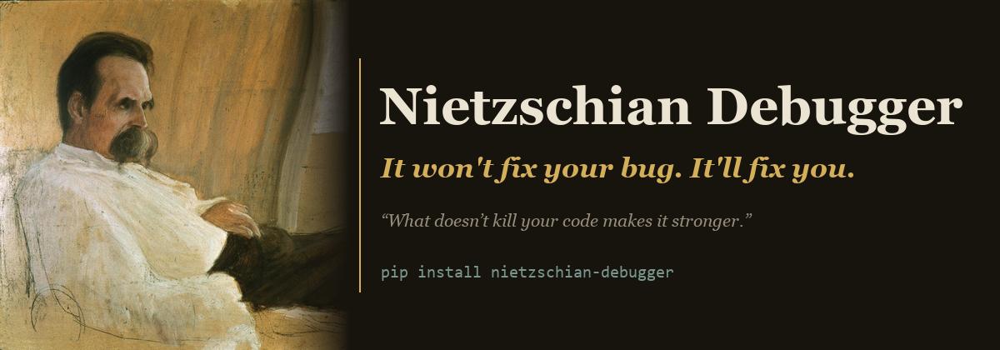

# Nietzschian Debugger



[](https://pypi.org/project/nietzschian-debugger/)
[](https://pypi.org/project/nietzschian-debugger/)
[](LICENSE)

> "What doesn't kill your code makes it stronger."

**It won't fix your bug. It'll fix you.** Every other tool hands you the answer; Nietzschian Debugger hands the question back.

You paste your bug. It doesn't fix it. Instead, it:

- Challenges your assumptions about what's happening
- Forces you to confront the evidence you're avoiding
- Attacks the assumption you're proudest of — the one you stopped questioning
- Guides you to the fix yourself — your realization, not the AI's

## Why?

AI is making developers weaker. Copy-paste from ChatGPT, ship, repeat. Nobody understands their own code anymore. **Nietzschian Debugger forges stronger developers** — through struggle, not shortcuts.

This isn't anti-AI — it runs on Claude, on purpose. It's anti-*outsourcing-your-thinking*. Every other tool uses the model to hand you the answer; this one uses it to hand the question back.

> "He who has a why to debug can bear almost any how."

## Installation

```bash
# Python 3.10+
pip install nietzschian-debugger
nietzschian debug "your bug"
```

**No API key yet? See it in action first — no key, no cost:**
```bash
nietzschian demo
```

> **Note:** the current tool is the Python package above. The old `npx nietzschian-debugger` serves a stale pre-rewrite build — it has been deprecated in favour of the pip install.

**Requirements:**
- Python >= 3.10
- An Anthropic API key (BYOK) — *or* bring another model (OpenAI, Gemini, DeepSeek, …), or run a local **Ollama** model, which needs no key. See [Use any model](#use-any-model).

## Setup

Set your Anthropic API key:

```bash
# Linux / macOS
export ANTHROPIC_API_KEY="sk-ant-..."

# Windows (PowerShell)
$env:ANTHROPIC_API_KEY = "sk-ant-..."

# Windows (CMD)
set ANTHROPIC_API_KEY=sk-ant-...
```

## Quick Start

```bash
# Start a debugging session (adaptive by default — it reads your state and shifts lens)
nietzschian debug "My API returns 500 but only on Tuesdays"

# Force a single lens instead of adapting
nietzschian debug --lens socrates "My login endpoint fails randomly"
nietzschian debug --lens zarathustra "Memory leak in production"

# Point it at specific code
nietzschian debug "Auth fails in ./src/middleware/auth.ts"

# Interrogate your actual uncommitted changes (feeds the git diff as context)
nietzschian debug --diff "tests started failing after my last change"

# Use any model — Claude by default; or OpenAI, Gemini, DeepSeek, local Ollama…
nietzschian debug --model ollama:llama3.1 "my function returns null sometimes"
```

## Use any model — API or local

Claude is the default and the sharpest experience, but you can bring any model —
most speak the OpenAI API, so they just work:

```bash
# Hosted (set the matching key: OPENAI_API_KEY, GEMINI_API_KEY, DEEPSEEK_API_KEY, …)
nietzschian debug --model openai:gpt-4o-mini "..."
nietzschian debug --model deepseek:deepseek-chat "..."
nietzschian debug --model gemini:gemini-1.5-flash "..."

# Local — no key, no cost, runs offline
nietzschian debug --model ollama:llama3.1 "..."
```

Install the provider deps once: `pip install "nietzschian-debugger[providers]"`.
Supported: **openai, gemini, deepseek, groq, mistral, together, openrouter, xai, ollama, lmstudio** — plus `custom:<model>` with `NIETZSCHIAN_BASE_URL` for any other OpenAI-compatible endpoint.

> Honest caveat: the "never give answers" discipline is sharpest on Claude. Smaller local models leak and over-ask more (the built-in validator catches some of it, not all).

## Share a session

Your sessions are made to be shared. Turn the last one into clean markdown:

```bash
nietzschian share            # most recent session, to your terminal
nietzschian share -o run.md  # or save it to a file
```

## Three Lenses — it picks, not you

By default it **adapts**: each turn it reads where you are and shifts between three methods. You don't choose a difficulty — a confused developer can't diagnose their own state, so the tool reads you instead. Nietzsche is home; it shifts only on sustained signals, not twitchily, and the active lens shows in every turn header (`[Turn 3 · socrates]`).

| When you're… | Lens | What it does |
|---|---|---|
| **confused** — you don't know what you mean | `socrates` | Relentless clarification. Defines your vague terms until a testable claim appears. The stingray, not a gentle mentor. |
| **avoiding** — hiding in an assumption | `nietzsche` | The tuning fork. Taps the idol you're proudest of and listens for the hollow ring. |
| **defeated** — ready to quit | `zarathustra` | Affirmation. Reframes the bug as the weight that makes you stronger, and will not let you quit. |

None of them is soft — **adaptivity changes the angle of the blade, never sheathes it.** To pin one lens instead of adapting:

```bash
nietzschian debug --lens socrates "my bug"
nietzschian debug --lens zarathustra "my bug"
```

## How a Session Looks

```
$ nietzschian debug "login endpoint returns 403, but only for users who signed up before last week; new signups work; same code path; Node/Express"

Nietzschian Debugger [Adaptive mode]


[Turn 1 · nietzsche]
You said "same code path" — but the data is screaming that something
changed between last week and today.

What is different about the user record itself between those who signed
up before last week and those who signed up after?

> I assumed the records were identical. Let me actually compare one.

[Turn 2 · nietzsche]
"Assumed." There is the word you built a week of debugging on. Stop
assuming and read two rows side by side.

What field exists on an old account that a new signup was never given?

> ...the old ones carry a legacy role claim the new ones don't, and the
  auth middleware rejects any token without it.

[Turn 3 · nietzsche]
There it is. The bug was never in the code — it was in your certainty
that "same code path" meant "same data." You stopped looking exactly
where the difference lived.

> found it

Session Complete -- 3 questions to root cause (Solved)

Your Debugging Profile:
┣ Assumption-checking    ████████░░  strong
┣ Evidence-gathering     ██████░░░░  moderate
┗ Root cause speed       ████████░░  strong

"Man is something that shall be overcome."
 -- Friedrich Nietzsche
```

**Or when you call a test "flaky":**

```
$ nietzschian debug "integration test passes locally but fails in CI — it's flaky, I just rerun until it's green"

Nietzschian Debugger [Adaptive mode]


[Turn 1 · nietzsche]
"Flaky." The word you reach for when a test has found something true and
you'd rather it hadn't. A test that fails one run in three isn't random —
it's telling you something is ordered that you assumed was not.

What does CI have, or do in a different order, that your machine does not?

> idk, maybe the database isn't ready yet

[Turn 2 · nietzsche]
"Maybe" — you named a suspect and refused to question it in the same
breath. A database that wasn't ready would throw a connection error, not a
wrong answer. Unless your test is reading rows another test wrote.

Do your tests share a database, and are they guaranteed to run in order?

> ...they share one. locally they always run alphabetically

[Turn 3 · nietzsche]
There it is. "Flaky" was the mask on a race you refused to see — two tests
fighting over the same rows, hidden on your machine by an accident of
alphabetical ordering that CI parallelizes away. The test was never flaky.
It was honest, and you were not.

Will you isolate the data, or keep rolling the dice until they fall green?

> oh. found it

Session Complete -- 3 questions to root cause (Solved)

Your Debugging Profile:
┣ Assumption-checking    ███████░░░  strong
┣ Evidence-gathering     █████░░░░░  moderate
┗ Root cause speed       ████████░░  strong

"No victor believes in chance."
 -- Friedrich Nietzsche
```

## Session Commands

| Command | Effect |
|---------|--------|
| `solved` or `found it` | End session — you found the root cause |
| `I give up` | Get one lifeline question, then exit |
| `exit` or `quit` | Abandon session immediately |
| `Ctrl+C` / `Ctrl+D` | Force quit |

## Features

- **Refuses to Hand You the Fix** — Every response is a question. It's built to withhold the answer, and a model-judge double-checks each reply to catch it when it slips.
- **Real Code Reading** — Reference a file path and it reads YOUR actual code, not generic examples. `--diff` feeds it your uncommitted changes.
- **Any Model, Even Local** — Claude by default; or OpenAI, Gemini, DeepSeek, Groq, and more — or a local Ollama / LM Studio model with no key and no cost.
- **Try With No Key** — `nietzschian demo` runs a full scripted session so you can see it before committing a key.
- **Shareable Sessions** — `nietzschian share` exports a session as clean markdown you can post.
- **Contextual Philosophy** — Nietzsche when you're avoiding, Seneca when overwhelmed, Sun Tzu when you need strategy.
- **Growth Score** — Track your debugging skills across sessions with visual bar charts.
- **Session History** — All sessions saved locally in `.nietzschian/sessions/` for trend tracking.
- **Sliding Context** — Long sessions don't crash; older turns are transparently summarized.

## Development

```bash
# Clone and install
git clone https://github.com/DilawarShafiq/nietzschian-debugger.git
cd nietzschian-debugger
pip install -e ".[dev]"

# Run the test suite
pytest

# Run the CLI locally
nietzschian debug "test problem"
```

## Tech Stack

- Python >= 3.10
- Claude API via the Anthropic SDK
- Click for the CLI, Rich for the terminal UI
- pytest for testing

## License

MIT
